<!-- yishu.asia, but on GitHub. Art & palette borrowed from the typewriter homepage. -->

  <a href="https://yishu.asia">
    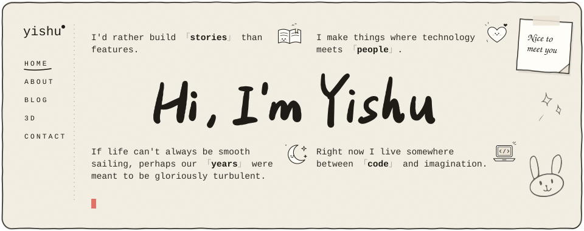
  </a>

  <a href="https://yishu.asia/#about">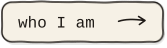</a>
  <a href="https://blog.yishu.asia/">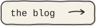</a>
  <a href="https://yishu.asia/#3d">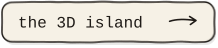</a>
  <a href="https://yishu.asia/#contact">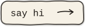</a>

 

  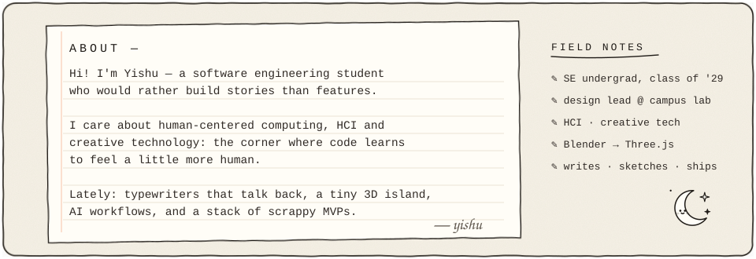

  <a href="https://yishu.asia">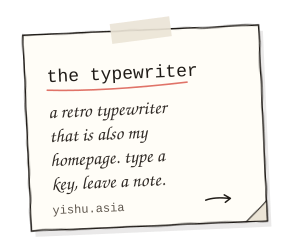</a>
  <a href="https://yishu.asia/#3d">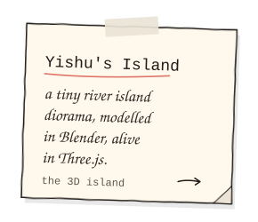</a>
  <a href="https://blog.yishu.asia/">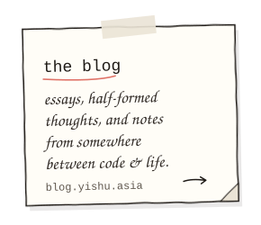</a>

  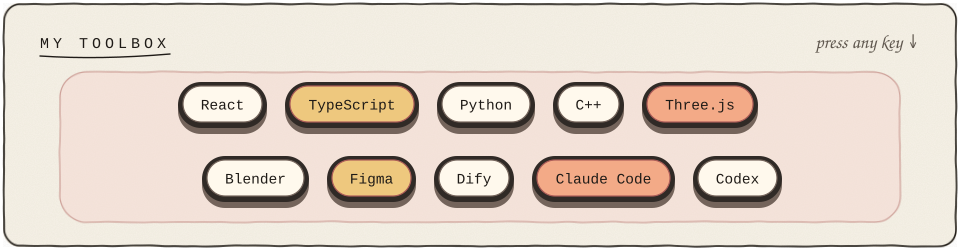

  <a href="https://yishu.asia">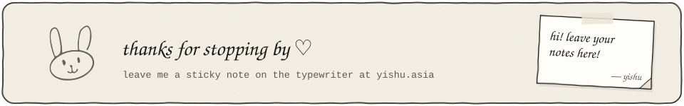</a>

