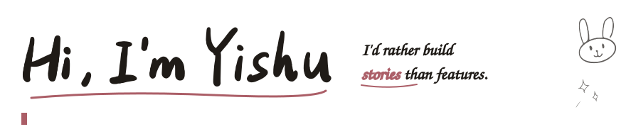

<a href="https://yishu.asia">yishu.asia</a> &nbsp;✎&nbsp; <a href="https://blog.yishu.asia/">the blog</a> &nbsp;✎&nbsp; <a href="https://yishu.asia/#3d">the 3D island</a> &nbsp;✎&nbsp; <a href="https://yishu.asia/#contact">say hi</a>

 

I'm a software engineering student who'd rather build **stories** than features — drawn to HCI and creative technology, the corner where code learns to feel a little more human. Lately: a typewriter that talks back, a tiny 3D river island, and a stack of scrappy MVPs.

 

  
  

<i>doodles redrawn every night by a tiny GitHub Action ✎</i>

